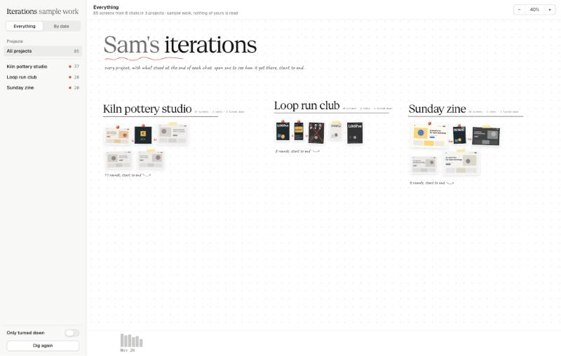
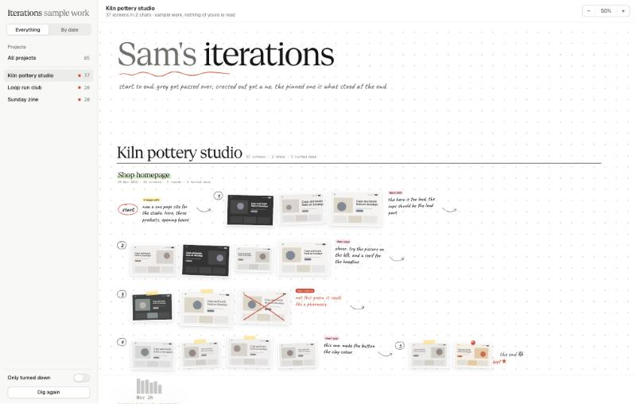

# Iterations

Every screen from every Claude Code chat, start to end, on one board.



When you design through an AI, you refine over the last output and the versions you passed over
leave no trail. The page of rejected iterations a designer used to keep is gone. Iterations puts
it back, from what your chats already left behind.

## Try it

```bash
npx @rayzorzrb/iterations --demo
```

The demo is three made-up projects drawn in code. It reads nothing of yours.

## What it does

Open a project and each chat runs from start to end, in rounds: what the session made, then what
you said about it, in your own words.



- Grey screens were passed over. A crossed-out one got a no. The pinned one is what stood at the
  end of the chat.
- Everything shows every project closed; click one to open it alone. By date shows one day at a
  time, with a bar of days along the bottom.
- Click a screen to see it full size, with what you said next.
- It finds Paper, browser, simulator and desktop screenshots, image files a session opened or
  sent you, pictures you pasted, and every version of a page a session published.
- Claude Code deletes old chats after a while. A small copy of every screen stays, and so does
  every sent file and published page.

## Run it on your own chats

You need a Mac, Node 20 or newer, and Claude Code. Chats that ran in the cloud don't reach it.

```bash
npx @rayzorzrb/iterations
```

The first run reads every chat on the Mac, which takes a little while. It opens in a window of
its own when Chrome, Brave or Edge is installed (`--browser` for an ordinary tab).

There is nothing to install into Claude Code: no hooks, no MCP server, no settings changed.
To remove it, delete `~/.iterations`.

## Privacy

- **Nothing leaves your Mac.** The code makes no outside network call, and the board is served
  with rules that stop it loading anything from anywhere but this Mac. There is no telemetry and
  no update check.
- **What it reads:** Claude Code's chat transcripts (`~/.claude/projects`), the Claude desktop
  app's list of chats (titles and folders), and the image files and pages a chat sent or
  published, while they are still on disk. It changes none of them.
- **What it keeps,** in `~/.iterations`: for each chat, when each screen was made and the first
  600 characters of each thing you typed; a small copy (420 px) of every screen; and a copy of
  each image file a chat sent you and each page it published, since their folders get cleared.
- **Screens can hold secrets.** If a key or a password was on screen in a screenshot, it is in a
  small copy too. Everything stays local, but know it is there.
- **Only this Mac can open the board.** It listens on `127.0.0.1` and answers only to
  `localhost`, so a website can't read it.
- **Old published pages** are shown cut off from the network. `--pages-online` lets them load
  their own fonts and scripts.
- To keep a client or a project off the board, list words from its chat title or folder in
  `~/.iterations/config.json`: `{ "private": ["acme"] }`.

## Things to know

- "Turned down" is a guess from the words you typed next ("no", "too busy", "go back"). It
  misses some and catches a few it shouldn't.
- "What stood at the end" is the last screen a session made in a chat, nothing cleverer.
- It reads files Claude Code writes for itself. If their shape changes, this needs a fix.

<details>
<summary>More</summary>

### Options

| Option | Does |
| --- | --- |
| `--demo` | Sample work only |
| `--name "Ana"` | Whose iterations they are |
| `--port 4798` | Another port |
| `--browser` | An ordinary browser tab |
| `--no-open` | Don't open a window |
| `--pages-online` | Let old published pages load their own fonts and scripts |
| `--json` | Print what was found and stop |

### Keys

| Key | Does |
| --- | --- |
| Scroll, drag | Move |
| Pinch, ⌘ scroll, + − | Zoom |
| 0 | Fit the width |
| ← → | The screen before or after; in By date, the day before or after |
| Space, Esc | Close a screen |

### Develop

No build step and no dependencies: `node bin/iterations.mjs`. `HOWITWORKS.md` says how it works.
`npm run audit` looks through the tracked files for anything that shouldn't ship.

</details>

## License

MIT. The fonts ship with it, so nothing is fetched: Geist and Geist Serif by Vercel, and Caveat
by Pablo Impallari, both under the SIL Open Font License (`src/fonts`).
